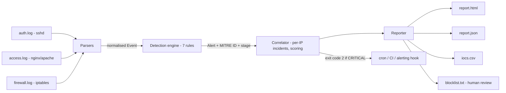

# Security Architecture

## 1. Purpose
Turn raw, noisy host and network logs into a short, prioritised list of incidents with evidence and a recommended response - the *detect -> analyse -> respond* part of the incident-response lifecycle.

## 2. Data flow

## 3. Components
| Module | Responsibility |
|---|---|
| `parsers.py` | Regex parsers -> normalised `Event(ts, source, ip, action, user, extra)`. Malformed lines are skipped, never crash the run. |
| `detectors.py` | Stateless rules using sliding time windows. All thresholds in `DEFAULTS`, overridable from CLI. |
| `correlator.py` | Groups alerts by IP, computes score (Low 1, Med 3, High 6, Crit 10), derives kill-chain stages, escalates multi-stage activity, attaches playbook text. |
| `report.py` | Writes HTML/JSON/CSV/blocklist. All log-derived text is HTML-escaped. |
| `cli.py` | Argument handling, orchestration, exit codes. |
| `tools/generate_sample_logs.py` | Synthetic log generator (benign noise + 3 simulated attackers) for repeatable testing. |

## 4. Detection logic
- **Sliding window:** events per IP are sorted and a two-pointer window finds the densest burst; an alert fires when the count meets the threshold inside the window. This avoids flagging slow, legitimate failures spread across hours.
- **Distinct-value windows** (usernames, destination ports) use a counter that is decremented as events leave the window.
- **Compromise rule:** a successful SSH login is CRITICAL if >= threshold failures from the same IP precede it inside the window.
- **Web signatures** run on the URL-decoded request target so `%20UNION%20SELECT` is caught.

## 5. Security design decisions
| Decision | Reason |
|---|---|
| Standard library only | No supply-chain exposure; auditable in an afternoon. |
| Read-only analysis; no automatic blocking | A false positive must never lock out a legitimate user; blocklist is a reviewable artefact. |
| Allowlist option | Exclude scanners and admin hosts you trust. |
| HTML escaping of all log-derived fields | Attackers control UA strings and usernames (log injection / stored XSS in the report). Covered by a unit test. |
| Synthetic data on RFC 5737 ranges | No real third-party addresses in the repo. |

## 6. Trust boundaries
1. **Untrusted:** log content (attacker-influenced) -> parsed with strict regexes, escaped on output.
2. **Trusted:** the analyst's machine and the CLI arguments.
3. **Output** is for human review; it is not executed by the tool.

## 7. Mapping to the incident-response lifecycle
Preparation (thresholds, allowlist) -> Detection (rules) -> Analysis (correlation, ATT&CK) -> Containment advice (playbook, blocklist) -> Lessons learned (tunable thresholds, tests).

## 8. Extending
Add a function in `detectors.py` returning `Alert` objects, append it to `ALL_RULES`, add a playbook line in `correlator.py`, add tests.
